# Project TDU2

**Rebuilding Test Drive Unlimited 2 from the ground up — powered by a custom game engine.**

Project TDU2 is an independent attempt to recreate the world, systems, and gameplay experience of *Test Drive Unlimited 2* using a completely custom-built game engine.

Unlike the previous Unity3D implementation, this project is being developed on a new foundation designed specifically around the requirements of TDU2.

The goal is to regain full control over rendering, performance, resource management, physics, audio, and gameplay systems — without being restricted by the architecture or limitations of an existing game engine.

  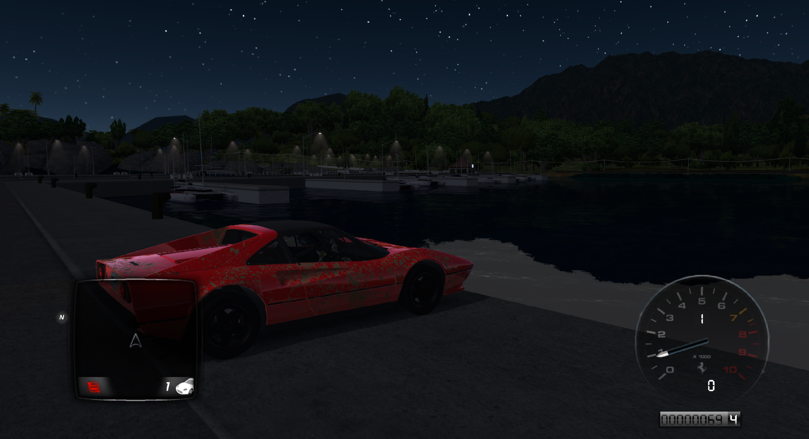
  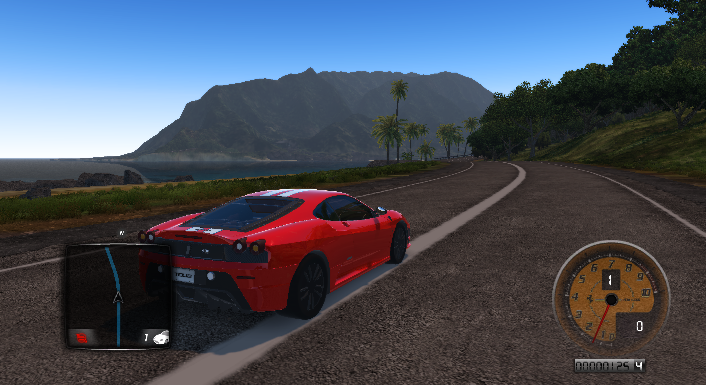

  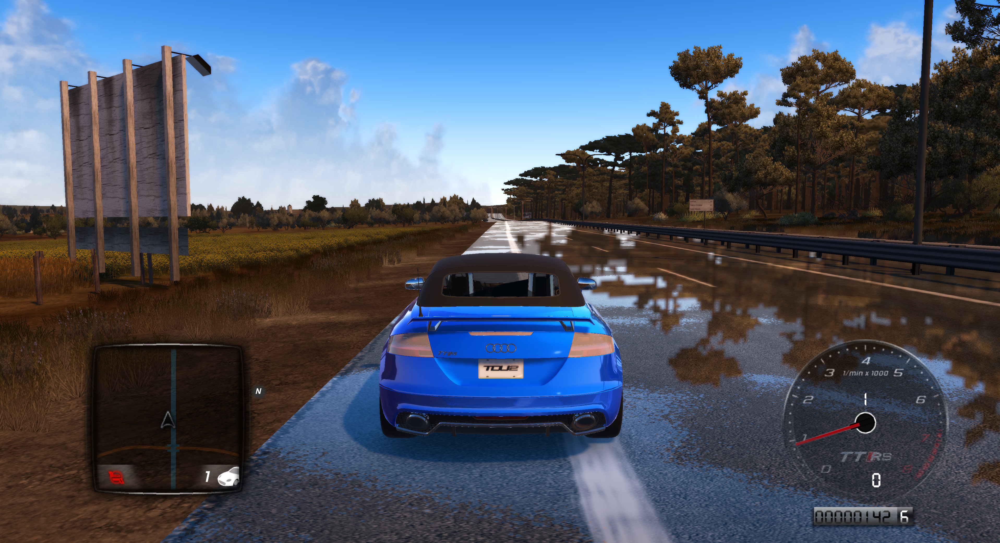
  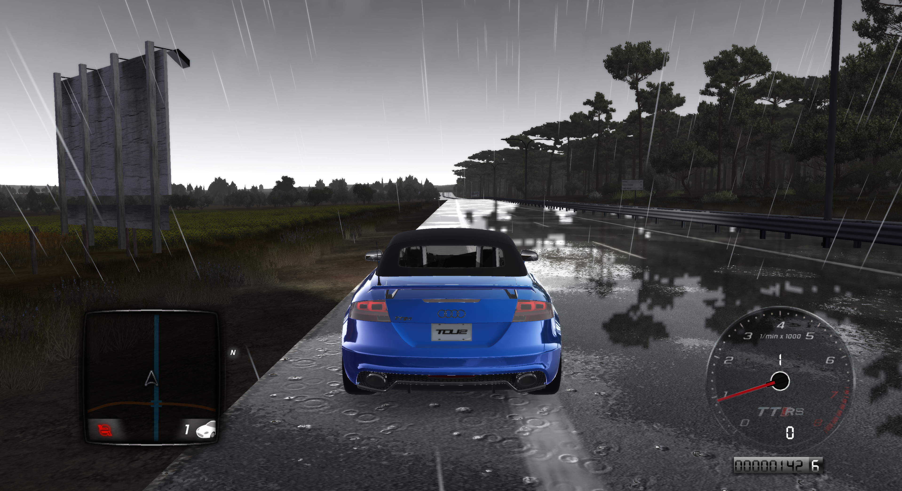

  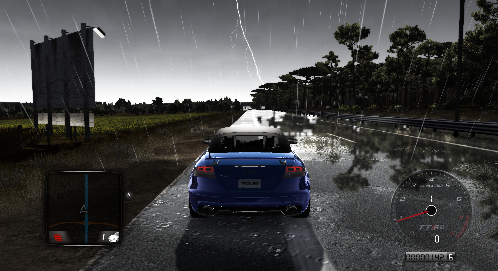
  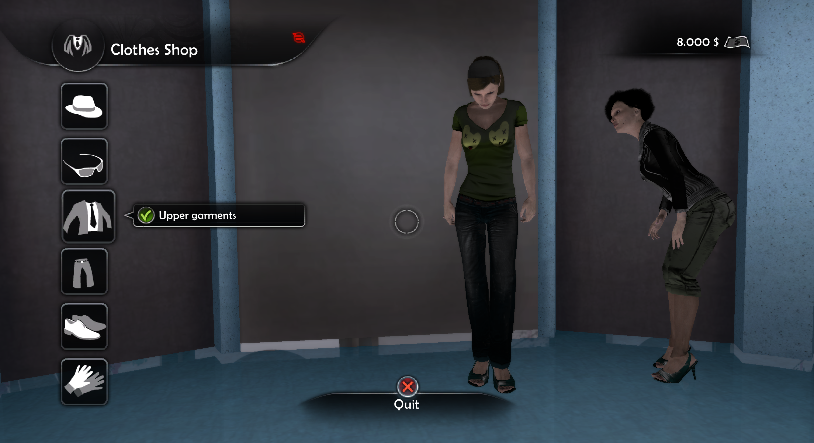

  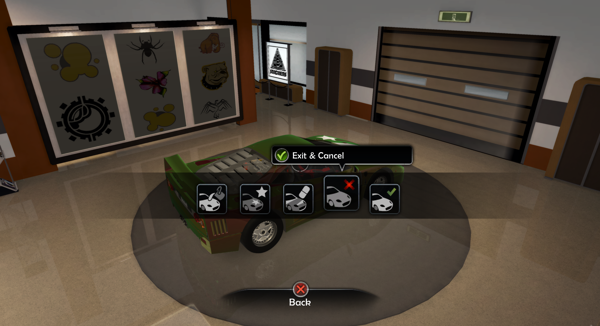
  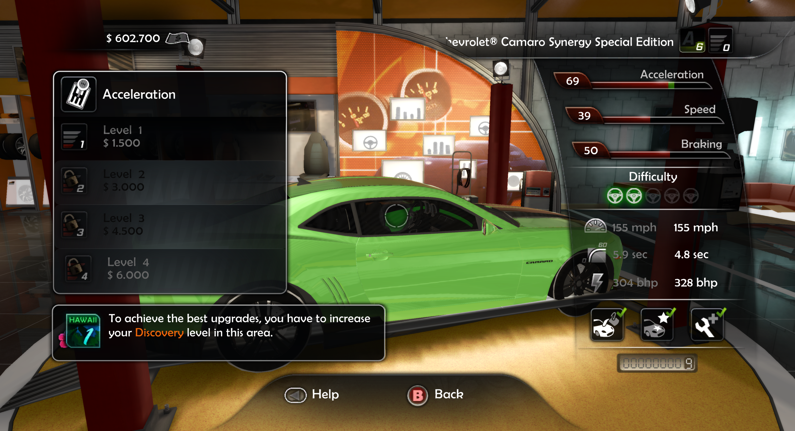

  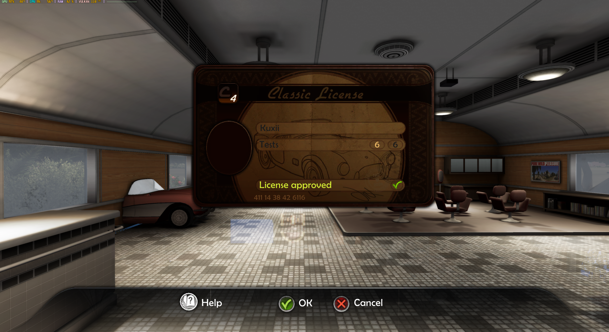
  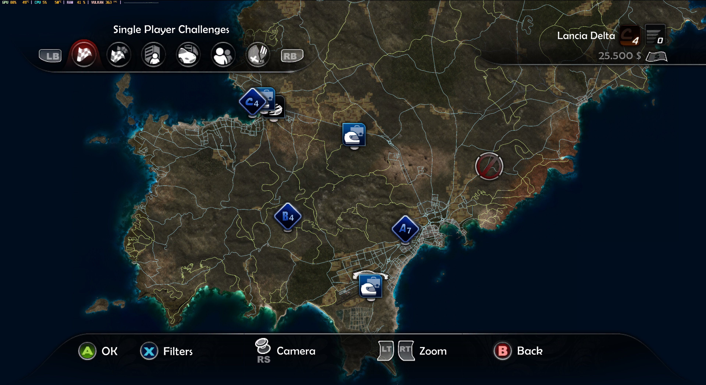

  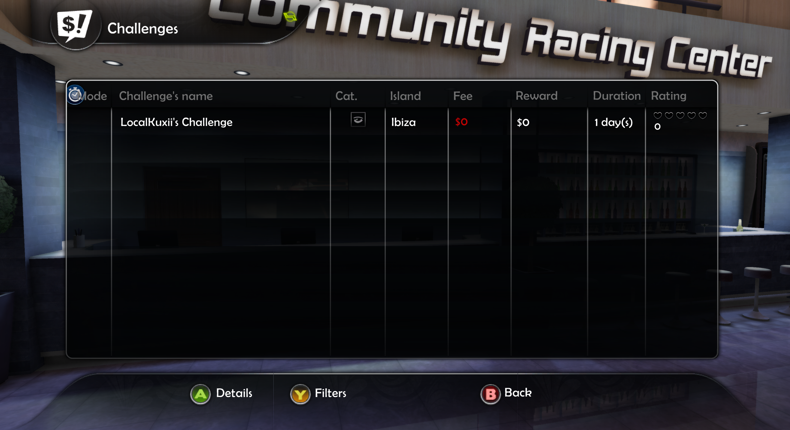
  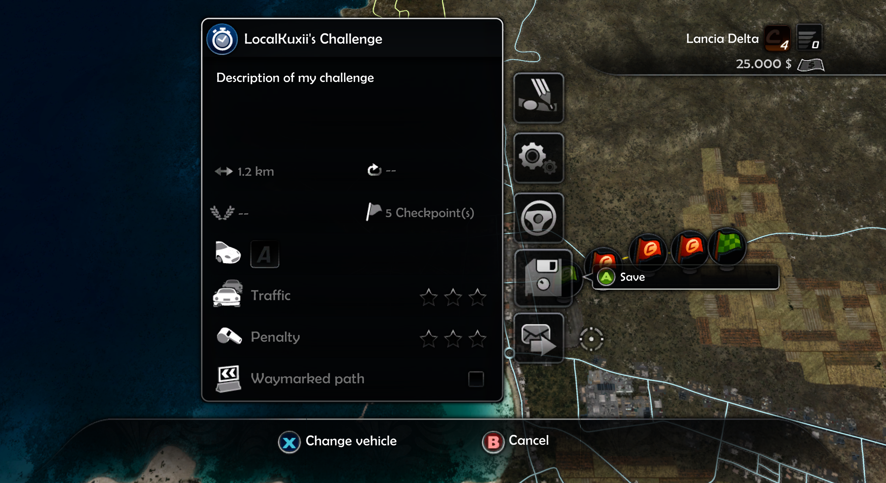

  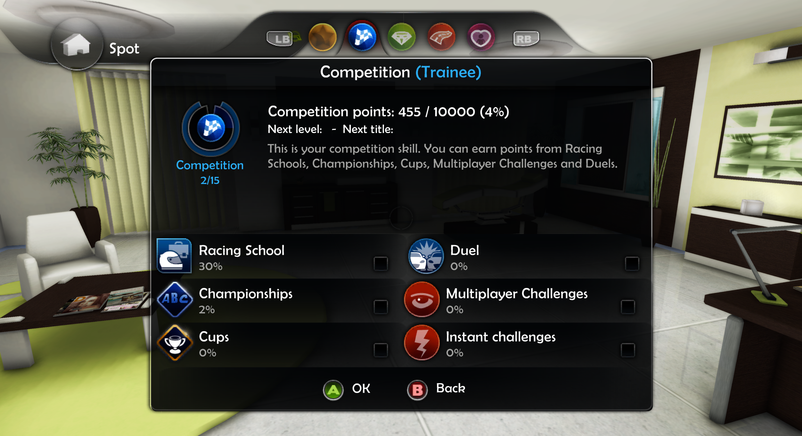
  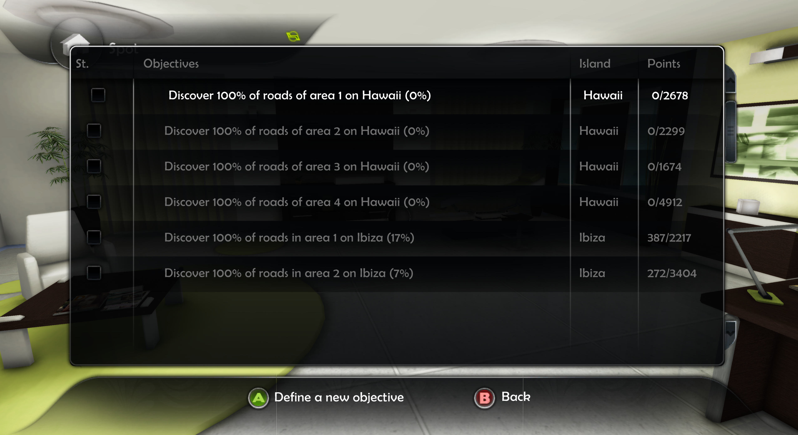

  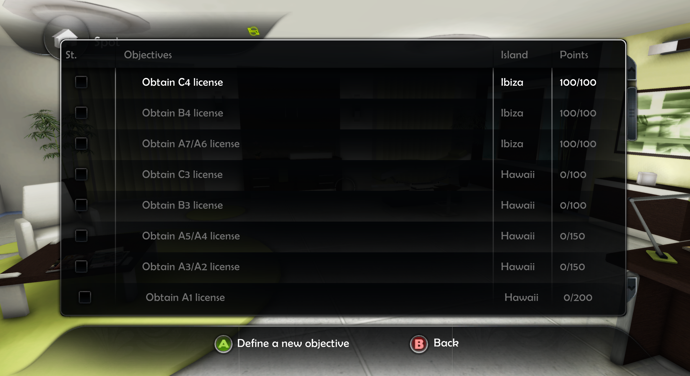
  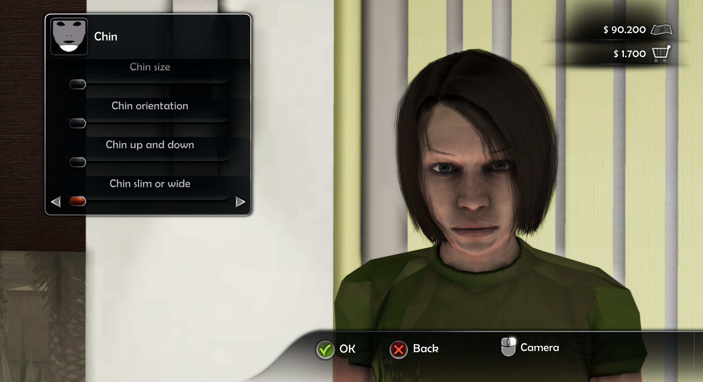

---

## Why a Custom Engine?

The previous TDU2 to Unity3D project demonstrated that recreating the original game was technically possible. However, Unity introduced performance overhead and architectural limitations that made further development increasingly difficult.

Too much time was spent working around engine limitations instead of developing the actual game.

Rather than continuing down that path, I decided to build my own engine.

This allows me to:

- Control the entire rendering pipeline.
- Optimize systems specifically for TDU2.
- Design custom asset and resource loading pipelines.
- Manage memory and performance more directly.
- Implement physics and gameplay systems without unnecessary engine overhead.
- Build features around the actual requirements of the project.

**The objective is simple: build the technology that the project actually needs instead of adapting the project to existing technology.**

## The Engine

Project TDU2 is powered by my own custom game engine, developed alongside the game itself.

The engine is designed to provide a flexible foundation for large open-world environments and the systems required to recreate TDU2.

### Current Technology

| Component | Technology |
|---|---|
| Rendering API | Vulkan |
| Audio | Custom Windows DirectSound-based audio system |
| Audio Processing | Custom Sound Mixer |
| Physics | Custom physics systems |
| Collision Detection | BepuPhysics |
| Engine Architecture | Custom-built |
| Asset Loading | Custom resource loading systems |
| Shaders | Custom shader pipeline |

The engine is actively evolving, and individual systems are being developed and optimized as the project progresses.

## Development Goals

The long-term goal is to recreate as much of the original Test Drive Unlimited 2 experience as possible.

### World and Environment

- Hawaii and Ibiza map support.
- Terrain and road rendering.
- Original world assets and resource formats.
- Vegetation and environmental objects.
- World collision and physics.
- Dynamic weather.
- Day/night cycle.
- Traffic systems.

### Vehicles and Driving

- Original vehicle models and resources.
- Vehicle spawning and management.
- Vehicle physics and handling.
- Vehicle customization.
- Lighting and animation systems.
- Garage and interior functionality.

### Gameplay

- Free Roam.
- Racing events.
- Driving schools.
- Houses and garages.
- Car and motorcycle dealerships.
- Original game activities and interactions.

### UI and Audio

- Original TDU2 interface recreation.
- Flash-based UI support.
- Radio stations and custom music.
- Original game audio.
- Dynamic radio messages.
- Custom audio management.

### Multiplayer

- Online connectivity.
- Player synchronization.
- Vehicle synchronization.
- In-game communication.
- Shared weather and time.
- Traffic synchronization.
- Shared gameplay activities.

These are long-term development goals, not a list of currently completed features.

## Development Status

<badge color="success">Active Development</badge>

Project TDU2 is currently in active development.

The engine and game systems are being built from the ground up. At this stage, the focus is on establishing a stable and performant foundation before implementing the larger gameplay systems.

As development progresses, this section will be updated with implemented features, improvements, and screenshots.

## Previous Project

Project TDU2 is the continuation of my previous project, [TDU2 to Unity3D](https://github.com/kuxii2016/TDU2_to_Unity3D).

The Unity implementation has been discontinued, but the experience, research, reverse-engineering work, and knowledge gained from it are being carried forward into this new project.

This is a new implementation, not a direct port of the previous Unity codebase.

## Requirements and Original Game Assets

Project TDU2 requires an original copy of *Test Drive Unlimited 2* for its game data and resources.

**Original game files and copyrighted assets are not included in this repository.**

Users must obtain their own copy of the original game and extract the required resources.

Further setup instructions and supported file structures will be documented as the project becomes ready for external testing.

## Disclaimer

Project TDU2 is an independent fan-made project and is not affiliated with, endorsed by, or associated with Eden Games or Atari.

*Test Drive Unlimited 2*, its trademarks, original assets, and associated intellectual property belong to their respective rights holders.

This project does not distribute original game assets.

## Final Words

Project TDU2 started with the idea of bringing an old favorite back to life.

The Unity implementation was an important step, but eventually I realized that I needed more control over the technology behind the project.

So instead of adapting to an existing engine, I decided to build my own.

**A custom engine. A new foundation. The same goal.**

Rebuilding TDU2, one system at a time.

